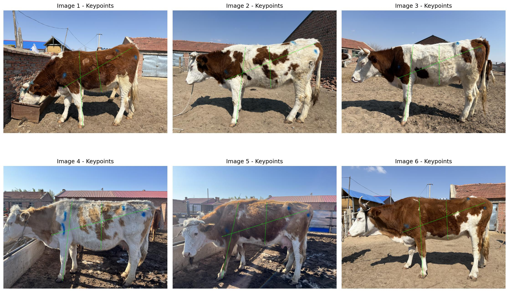
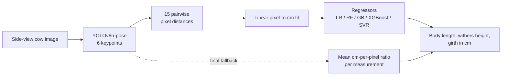
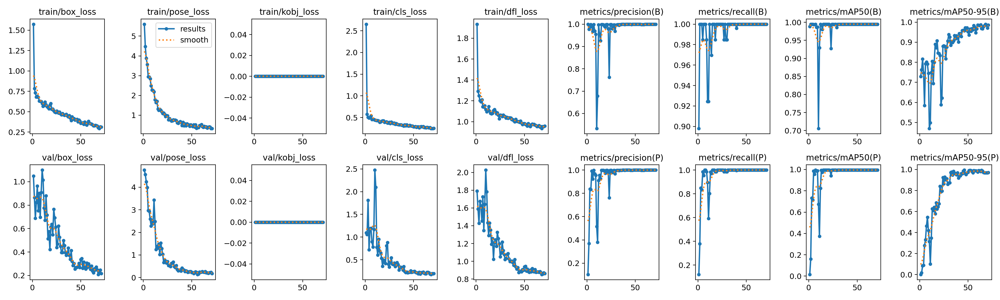
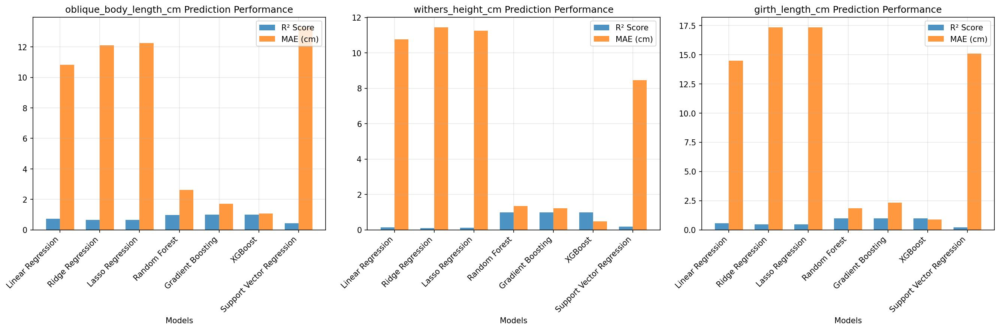
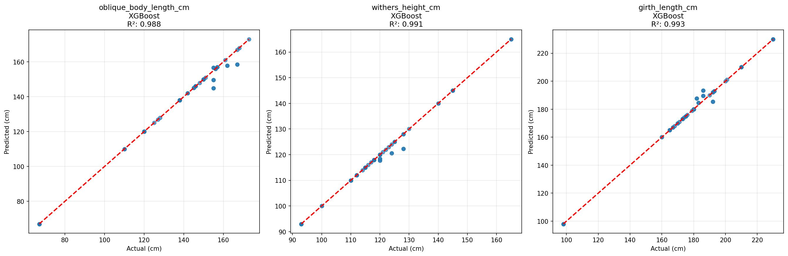
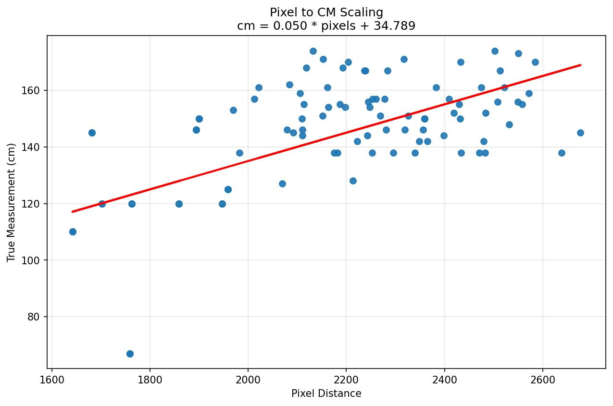

# VETRA v1.1 — Cattle body measurements from pose keypoints

First machine-learning experiment for **VETRA (Vision-Enabled Type Recording Assistant)**: a YOLOv8n-pose model finds 6 body landmarks on side-view cow photos, and regression models turn keypoint distances into body measurements in centimetres.


<p align="center">
  
</p>

> [!NOTE]
> This is an **archived early prototype**, superseded by [VETRA-v2.0](https://github.com/rupeshbharambe24/VETRA-v2.0) and then by the final models in [VETRA-v3.0](https://github.com/rupeshbharambe24/VETRA-v3.0) and the [VETRA---App](https://github.com/rupeshbharambe24/VETRA---App) system. It is kept as a record of how the project started. Read the [known limitations](#known-limitations) before reusing any number from it.

## Contents

- [Overview](#overview)
- [What's new in this version](#whats-new-in-this-version)
- [Pipeline](#pipeline)
- [Results](#results)
- [Known limitations](#known-limitations)
- [Project structure](#project-structure)
- [Getting started](#getting-started)
- [Dataset](#dataset)
- [VETRA project map](#vetra-project-map)
- [License](#license)

## Overview

**Problem.** Type classification of cattle and buffalo (Smart India Hackathon 2025, Rashtriya Gokul Mission / NDDB-style trait recording) needs body measurements such as body length, height at withers and heart girth. Taking them by hand with a tape is slow and inconsistent.

**Approach in v1.1.**
1. Fine-tune **YOLOv8n-pose** to detect a cow and 6 keypoints (three landmark pairs, one per measurement).
2. Compute all 15 pairwise keypoint distances and convert them from pixels to cm with a linear fit.
3. Train 7 regressors (linear, ridge, lasso, random forest, gradient boosting, XGBoost, SVR) to predict the three tape measurements.
4. Chain them into an inference function, then debug it. The final cells fall back to **dataset-average cm-per-pixel ratios** for each measurement.

**Highlights**
- One notebook covers the whole flow: pose training, keypoint visualisation, feature engineering, regression benchmarking and inference.
- 138 images have tape-measured ground truth (`data/measurements.xlsx`: oblique body length, withers height, girth length).
- Every trained artefact is committed: YOLO run and weights, 15 pickled regressors and scalers, metric CSVs and figures.

## What's new in this version

v1.1 is the first VETRA version on GitHub. Its git history has three commits: the initial pose-training and regression pipeline, then "Visualization & Measurement Scaling Added", then "Pipeline Updated" (the inference debugging and the cm-per-pixel fallback). [VETRA-v2.0](https://github.com/rupeshbharambe24/VETRA-v2.0) then changed the design: separate side-view (10 kp) and back-view (8 kp) models, more measurements, and scaling factors per measurement.

## Pipeline



The keypoint pairs are `(0,1)` oblique body length, `(2,3)` withers height and `(4,5)` girth (see `configs/data.yaml`).

## Results

All numbers below are copied from the notebook outputs and `results/*.csv`. Read them together with the [known limitations](#known-limitations).

### Pose model (YOLOv8n-pose, 6 keypoints)

Run `runs/pose/yolov8_cow_pose_v1`: 100 epochs requested, early-stopped after 71 (best at epoch 61), on an RTX 3050 Ti Laptop GPU.

| Split | Images | Box mAP50 | Box mAP50-95 | Pose mAP50 | Pose mAP50-95 |
|---|---|---|---|---|---|
| val | 66 | 0.995 | 0.985 | 0.995 | 0.990 |

<details>
<summary>Training curves</summary>



</details>

### Regression benchmark (test split, `results/model_performance_summary.csv`)

| Target | Best model | R² | MAE (cm) | 5-fold CV R² (train) |
|---|---|---|---|---|
| Oblique body length | XGBoost | 0.988 | 1.07 | 0.907 |
| Withers height | XGBoost | 0.991 | 0.47 | 0.945 |
| Girth length | XGBoost | 0.993 | 0.89 | 0.962 |

The linear models reached R² of only 0.11 to 0.73 on the same split. The tree ensembles scored far higher, but much of that gap comes from the duplicate-row leakage explained below.

<details>
<summary>All 21 model / target combinations</summary>

| Target | Model | R² | MAE | RMSE | CV R² |
|---|---|---|---|---|---|
| oblique_body_length_cm | Linear Regression | 0.734 | 10.82 | 13.10 | 0.576 |
| oblique_body_length_cm | Ridge | 0.666 | 12.10 | 14.67 | 0.570 |
| oblique_body_length_cm | Lasso | 0.658 | 12.26 | 14.83 | 0.525 |
| oblique_body_length_cm | Random Forest | 0.970 | 2.63 | 4.40 | 0.912 |
| oblique_body_length_cm | Gradient Boosting | 0.987 | 1.70 | 2.92 | 0.918 |
| oblique_body_length_cm | XGBoost | 0.988 | 1.07 | 2.84 | 0.907 |
| oblique_body_length_cm | SVR | 0.426 | 13.29 | 19.23 | 0.241 |
| withers_height_cm | Linear Regression | 0.150 | 10.76 | 13.40 | 0.168 |
| withers_height_cm | Ridge | 0.106 | 11.45 | 13.74 | 0.174 |
| withers_height_cm | Lasso | 0.109 | 11.26 | 13.71 | 0.184 |
| withers_height_cm | Random Forest | 0.976 | 1.34 | 2.26 | 0.929 |
| withers_height_cm | Gradient Boosting | 0.983 | 1.22 | 1.92 | 0.954 |
| withers_height_cm | XGBoost | 0.991 | 0.47 | 1.37 | 0.945 |
| withers_height_cm | SVR | 0.173 | 8.46 | 13.21 | -0.061 |
| girth_length_cm | Linear Regression | 0.564 | 14.49 | 17.93 | 0.460 |
| girth_length_cm | Ridge | 0.474 | 17.34 | 19.71 | 0.460 |
| girth_length_cm | Lasso | 0.472 | 17.34 | 19.74 | 0.404 |
| girth_length_cm | Random Forest | 0.989 | 1.85 | 2.88 | 0.942 |
| girth_length_cm | Gradient Boosting | 0.971 | 2.34 | 4.60 | 0.941 |
| girth_length_cm | XGBoost | 0.993 | 0.89 | 2.28 | 0.962 |
| girth_length_cm | SVR | 0.196 | 15.09 | 24.36 | 0.007 |

</details>

| Model comparison | Best-model predictions |
|---|---|
|  |  |

### Pixel-to-cm scaling

The global linear fit was `cm = 0.0501 × px + 34.79`, with **R² = 0.39** on the oblique-length pair. The final fallback in the notebook uses mean cm-per-pixel ratios over 137 images instead: 0.0670 (oblique length), 0.0677 (withers height) and 0.1897 (girth). For example, image `29.png` comes out at 160.7 / 143.2 / 203.4 cm.



## Known limitations

These come from reading the notebook outputs and data. They explain why v2.0 changed the approach.

- **Duplicated rows in the regression data.** `results/cow_features.csv` holds 276 rows for 138 images: every row appears twice, because the feature-building loop ran twice. The 80/20 split therefore puts copies of training rows into the test set, so the R² ≈ 0.99 results above are optimistic.
- **Pose validation overlaps training.** In `data/yolo_split`, 64 of the 66 validation filenames also appear in `train/`, and 45 of the validation images are byte-identical to training images. The pose mAP is therefore not a held-out estimate.
- **End-to-end inference produced constant output.** Chained to the YOLO model, the saved regressors returned the same value (99.2 cm) for every measurement and image. You can see this in `results/figures/test2_measurements.jpg`. The notebook traces it to a feature-scaling mismatch at inference time and ends with the cm-per-pixel fallback.
- **No physical reference.** Scale is inferred from the dataset rather than measured in the photo. Camera distance changes the result. Later versions add an ArUco marker (v3.0).

## Project structure

```text
VETRA-v1.1/
├── notebooks/
│   └── vetra_v1.1.ipynb           # end-to-end notebook (steps 1-5 + debugging)
├── configs/
│   └── data.yaml                  # YOLO pose dataset config (6 kp, 1 class)
├── data/
│   ├── images/                    # 141 raw cow images (jpg/png)
│   ├── labels/                    # 138 YOLO keypoint labels
│   ├── measurements.xlsx          # tape-measured ground truth per image_id
│   └── yolo_split/                # train (136) / val (66) copy used for YOLO training
├── models/
│   ├── pretrained/                # yolov8n-pose.pt base weights (+ yolo11n.pt used by Ultralytics AMP check)
│   └── regressors/                # 15 pickled regressors and feature scalers
├── runs/
│   └── pose/yolov8_cow_pose_v1/   # Ultralytics run: curves, batches, weights/best.pt
├── results/
│   ├── cow_features.csv           # pairwise-distance features (cm) + targets
│   ├── model_performance_summary.csv
│   ├── figures/                   # comparison plots, scaling plot, annotated test outputs
│   └── keypoint_visualizations/   # per-image keypoint overlays
├── assets/samples/                # test1.jpg, test2.jpg input images
├── requirements.txt
└── LICENSE
```

> [!WARNING]
> The repository is about **4.8 GB** on disk, mostly full-resolution images in `data/`. Cloning takes a while. Use `git clone --depth 1` if you don't need the history.

## Getting started

**Prerequisites:** Python 3.11, and an NVIDIA GPU with CUDA if you want to retrain (it was trained on a 4 GB RTX 3050 Ti). Inference also runs on CPU.

```bash
git clone --depth 1 https://github.com/rupeshbharambe24/VETRA-v1.1.git
cd VETRA-v1.1
python -m venv .venv && source .venv/bin/activate   # Windows: .venv\Scripts\activate
pip install -r requirements.txt
jupyter notebook notebooks/vetra_v1.1.ipynb
```

The first code cell moves the working directory to the repo root, so every path in the notebook (`data/`, `configs/`, `runs/`, `models/`, `results/`) resolves wherever Jupyter was started. Step 1 (pose training) uses `device=0`. Change it to `"cpu"` if you have no GPU, or skip that step and use the committed `runs/pose/yolov8_cow_pose_v1/weights/best.pt`.

Quick keypoint inference with the trained model:

```python
from ultralytics import YOLO

model = YOLO("runs/pose/yolov8_cow_pose_v1/weights/best.pt")
result = model.predict("assets/samples/test1.jpg", imgsz=640, conf=0.5)[0]
print(result.keypoints.xy)   # (1, 6, 2) pixel coordinates
```

## Dataset

- 141 cow images (69 jpg, 72 png) with 6-keypoint YOLO labels, and a spreadsheet of tape measurements for 138 of them.
- **Provenance and licence are not documented in the repo.** Some images look like web photos and carry third-party watermarks; `assets/samples/test2.jpg`, for example, has a photographer/organisation watermark. Treat the images as research-only. Check the rights before redistributing them, or replace them with team-collected photos.

## VETRA project map

VETRA (SIH 2025, Grand Finale Top 5) is split across several repositories. ML work evolved v1.1 → v2.0 → v2.2 → v3.0; the apps below consume or capture data for those models.

| Repository | What it is | Stack | Status |
|---|---|---|---|
| **[VETRA-v1.1](https://github.com/rupeshbharambe24/VETRA-v1.1)** (this repo) | First ML experiment: 6-keypoint YOLOv8n-pose on side-view cow images + regressors mapping keypoint distances to body measurements (cm) | Python, YOLOv8-pose, scikit-learn | Archived (ML) |
| [VETRA-v2.0](https://github.com/rupeshbharambe24/VETRA-v2.0) | Separate side (10 kp) and back (8 kp) YOLOv8n-pose models, per-measurement pixel-to-cm scaling, measurement extraction, prototype type/breed scoring | Python, Ultralytics | Archived (ML) |
| [VETRA-v2.2-with-app](https://github.com/rupeshbharambe24/VETRA-v2.2-with-app) | v2 pipeline retrained and wrapped in a first FastAPI backend + React UI (`/api/v1/process-image`) | Python, FastAPI, React | Archived (ML + app) |
| [VETRA-v3.0](https://github.com/rupeshbharambe24/VETRA-v3.0) | Final training: side (14 kp), back (10 kp) and udder-bottom (8 kp) YOLOv8n-pose models, udder U-Net + ResNet18, ArUco scaling, dataset tooling | Python, Ultralytics, PyTorch | Final models |
| [VETRA---App](https://github.com/rupeshbharambe24/VETRA---App) | Final system: FastAPI backend serving the v3.0 pose models + udder U-Net/ResNet18, NDDB-style trait scoring, React web UI | FastAPI, PyTorch, React + Vite | Final (SIH 2025 finale) |
| [vetra-main-app-latest-v3](https://github.com/rupeshbharambe24/vetra-main-app-latest-v3) | Flutter field app: capture protocol, offline SQLite records, PDF reports (not yet wired to the analysis API) | Flutter, Riverpod, SQLite | Prototype |
| [vetra-depth-recorder-latest-v3](https://github.com/rupeshbharambe24/vetra-depth-recorder-latest-v3) | RGB + ARCore depth capture with intrinsics, pose and ZIP export | Flutter, Kotlin, ARCore | Prototype |
| [VETRA---Depth-Recorder](https://github.com/rupeshbharambe24/VETRA---Depth-Recorder) | Earlier capture app: RGB frames + phone-sensor pose metadata (no real depth) | Expo / React Native, TypeScript | Superseded |
| [vetra-pashu-scan](https://github.com/rupeshbharambe24/vetra-pashu-scan) | Early Lovable-generated PWA UI; Supabase edge functions return mock measurements | Vite, React, Supabase | Superseded (UI prototype) |
| [pashudhan-ui](https://github.com/rupeshbharambe24/pashudhan-ui) | Fork of a teammate's Lovable UI prototype (landing page + mock prediction page) | Vite, React | Fork |

## Acknowledgements

Built by **Rupesh Bharambe** for the VETRA team at Smart India Hackathon 2025. Pose estimation uses [Ultralytics YOLOv8](https://github.com/ultralytics/ultralytics).

## License

Code is released under the [MIT License](LICENSE). The images and measurements in `data/` are not covered by it. See [Dataset](#dataset).
